# 🏦 BNP Paribas — Détection de churn bancaire

> **Prédiction du désabonnement client** via CatBoost + API FastAPI

[](https://www.python.org/)
[](https://catboost.ai/)
[](https://fastapi.tiangolo.com/)
[](https://scikit-learn.org/)
[](.)
[](.)
[](LICENSE)
[](.)

---

## 📋 Table des matières

- [🎯 Objectif](#-objectif)
- [📊 Résultats](#-résultats)
- [📊 Analyse exploratoire (EDA)](#-analyse-exploratoire-eda)
- [🔧 Feature engineering](#-feature-engineering)
- [🎯 Modélisation](#-modélisation)
- [🧠 Interprétabilité](#-interprétabilité)
- [📈 Exemples de prédictions](#-exemples-de-prédictions)
- [🏗️ Structure du projet](#️-structure-du-projet)
- [🚀 Installation & lancement](#-installation--lancement)
- [🔌 API Endpoints](#-api-endpoints)
- [🛠️ Stack technique](#️-stack-technique)
- [📊 Livrables](#-livrables)
- [🎯 Impact business](#-impact-business)
- [🎓 Compétences mobilisées](#-compétences-mobilisées)
- [🚀 Perspectives](#-perspectives)
- [👤 Auteur](#-auteur)

---

## 🎯 Objectif

Identifier **à l'avance** les clients à risque de désabonnement (churn) pour leur proposer une **offre personnalisée** et réduire l'attrition bancaire.

| Contexte | Détail |
|---|---|
| **Entreprise** | BNP Paribas |
| **Dataset** | [Kaggle Churn Modelling](https://www.kaggle.com/datasets/shantanudhakadd/bank-customer-churn-prediction) |
| **Clients** | 10 000 |
| **Cible** | `Exited` (0 = reste, 1 = part) |
| **Taux de churn** | **20.37 %** |
| **Type de problème** | Classification binaire déséquilibrée |

### 💡 Enjeux business

- **Coût d'acquisition** : 5 à 10× plus cher qu'un client retenu
- **Perte annuelle par churner** : ~500 à 2 000 €
- **Opportunité** : 1 % de churn évité = millions d'euros pour une grande banque

---

## 📊 Résultats

### Performances du modèle final

| Métrique | Valeur | Benchmark Kaggle | Statut |
|---|---|---|---|
| **F1-Score** | **0.6425** | 0.55 - 0.60 | ✅ Dépassé |
| **ROC-AUC** | **0.8688** | 0.80 - 0.85 | ✅ Dépassé |
| **Recall** | ~0.75 | — | — |
| **Precision** | ~0.55 | — | — |
| **Accuracy** | ~0.81 | — | — |

🏆 **Modèle retenu** : **CatBoost** + **feature engineering** + **seuil optimal (0.58)**

### Comparaison des modèles

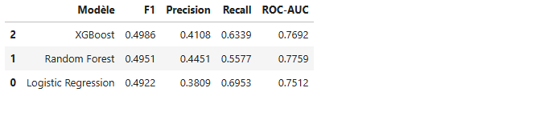

| Modèle | F1 | ROC-AUC |
|---|---|---|
| 🥇 **CatBoost + FE** | **0.6425** | **0.8688** |
| 🥈 Stacking (XGB+LGB+Cat) | 0.6304 | 0.8615 |
| 🥉 Voting | 0.6220 | — |
| XGBoost + FE | 0.6032 | 0.8439 |
| LightGBM + FE | 0.5922 | 0.8486 |
| XGBoost baseline | 0.4986 | 0.7692 |

**Gain vs baseline** : **+29 % F1**, **+13 % ROC-AUC**

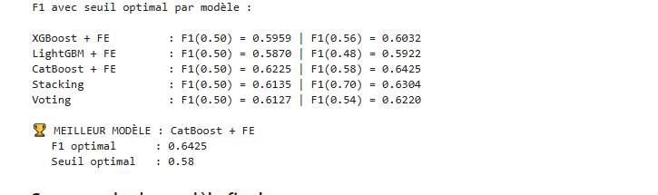

### 🎯 Progression depuis le début

| Étape | F1 | ROC-AUC |
|---|---|---|
| XGBoost baseline | 0.4986 | 0.7692 |
| **CatBoost + FE + seuil** | **0.6425** | **0.8688** |
| **Gain total** | **+0.144** (+29 %) | **+0.100** (+13 %) |

---

## 📊 Analyse exploratoire (EDA)

### Distribution de la cible

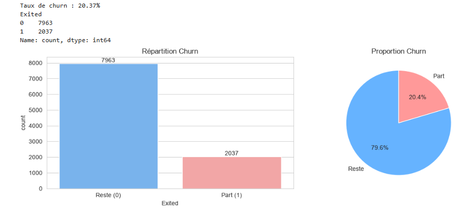

- **79.63 %** restent (7963 clients)
- **20.37 %** partent (2037 clients)
- **Ratio** : ~1:4 (déséquilibre modéré)

### Statistiques descriptives

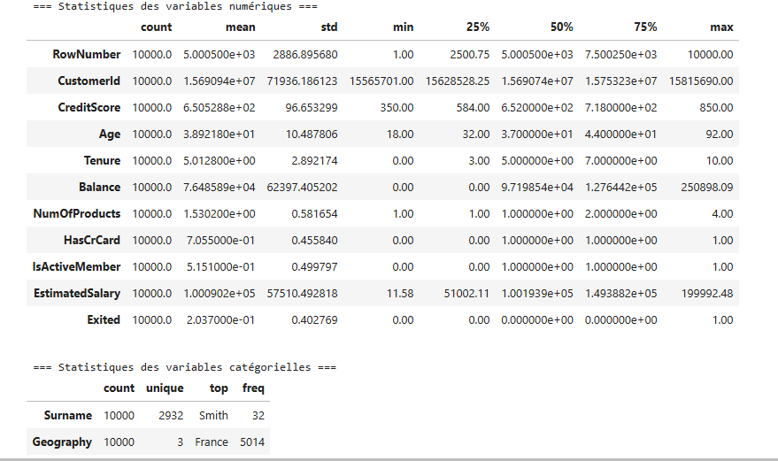

### Distributions des variables numériques

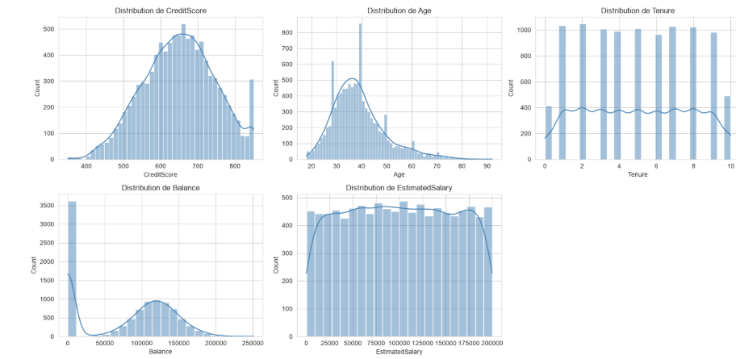

### Distributions des variables catégorielles

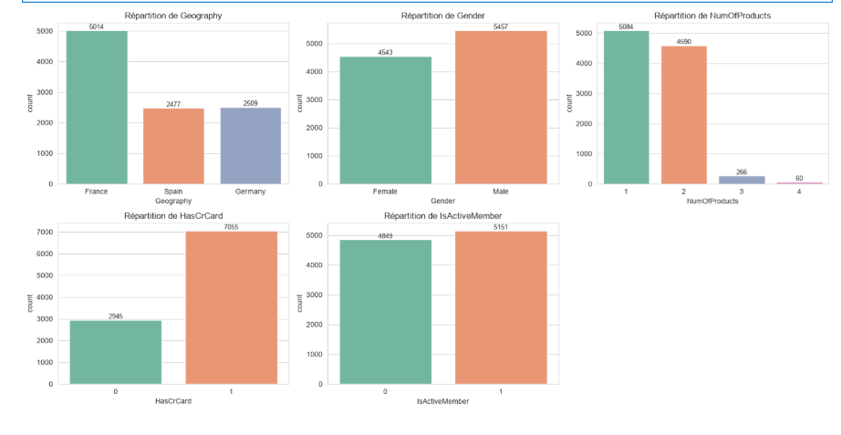

### Analyse bivariée

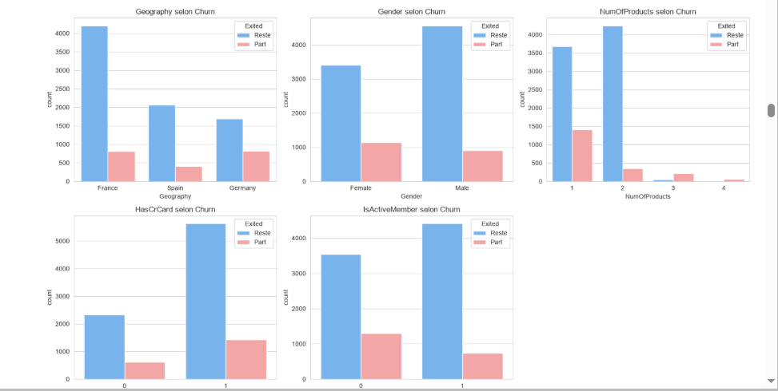

### Matrice de corrélation

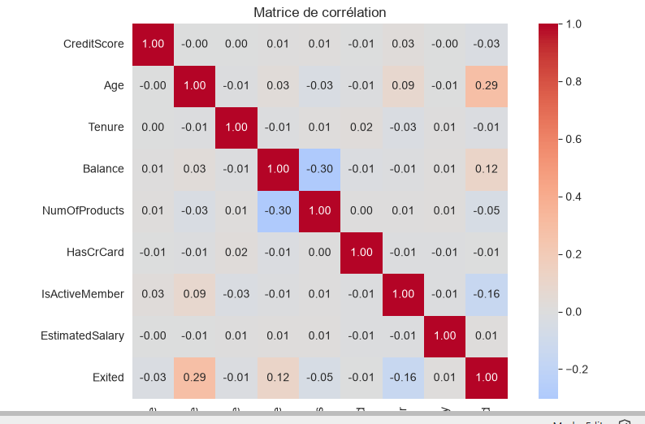

#### Top corrélations avec `Exited`

| Variable | Corrélation | Impact |
|---|---|---|
| `Age` | **+0.285** | 🔴🔴🔴 |
| `Balance` | +0.119 | 🔴🔴 |
| `IsActiveMember` | **-0.156** | 🟢 Protecteur |
| `NumOfProducts` | -0.048 | ⚠️ Non-linéaire |
| Les autres | ~0 | ⚪ Négligeable |

---

## 🔧 Feature engineering

**8 nouvelles features** créées pour améliorer la prédiction :

| Feature | Formule | Intuition |
|---|---|---|
| `Age_At_Join` | `Age - Tenure` | Âge au moment d'adhérer |
| `Tenure_Ratio` | `Tenure / Age` | Part de vie dans la banque |
| `Balance_Salary_Ratio` | `Balance / EstimatedSalary` | Épargne relative |
| `Balance_Per_Product` | `Balance / NumOfProducts` | Concentration |
| `Products_Per_Tenure` | `NumOfProducts / Tenure` | Intensité d'engagement |
| `CreditScore_Age` | `CreditScore / Age` | Profil risque |
| `Has_Zero_Balance` | `Balance == 0` | Signal fort |
| `Engagement_Score` | Composite | Score d'engagement |

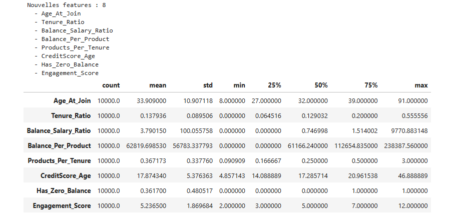

### 📈 Impact du feature engineering

| Modèle | F1 (sans FE) | F1 (avec FE) | Gain |
|---|---|---|---|
| XGBoost | 0.4986 | 0.5959 | **+0.097** |
| **CatBoost** | — | **0.6425** | — |

✅ **Le feature engineering apporte +0.10 sur le F1**.

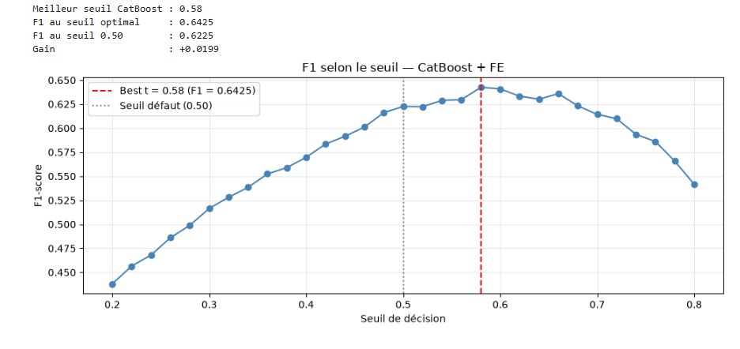

---

## 🎯 Modélisation

### Seuil de décision optimal

Le seuil par défaut (0.50) **n'est pas optimal** pour maximiser le F1.

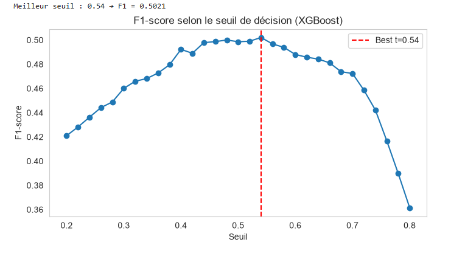

**Seuil optimal trouvé** : **0.58**

| Seuil | F1 |
|---|---|
| 0.50 (défaut) | 0.6225 |
| **0.58 (optimal)** | **0.6425** |
| **Gain** | **+0.020** |

### Distribution des probabilités

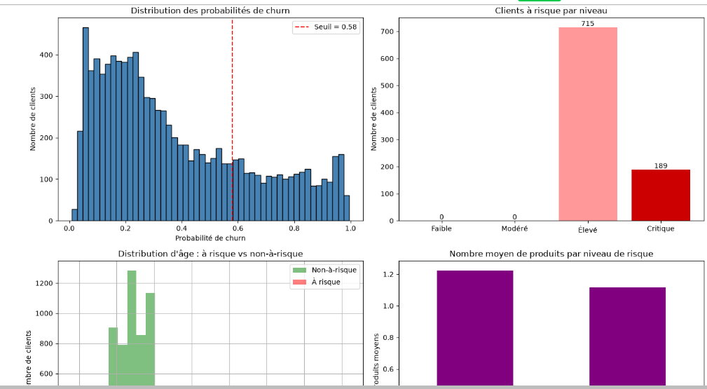

### 🏆 Hyperparamètres finaux (CatBoost)

```python
CatBoostClassifier(
    iterations=1000,
    depth=6,
    learning_rate=0.05,
    l2_leaf_reg=3,
    scale_pos_weight=3.91,
    eval_metric='Logloss',
    early_stopping_rounds=50,
    random_state=42
)
```

---

## 🧠 Interprétabilité

### Feature importance (SHAP)

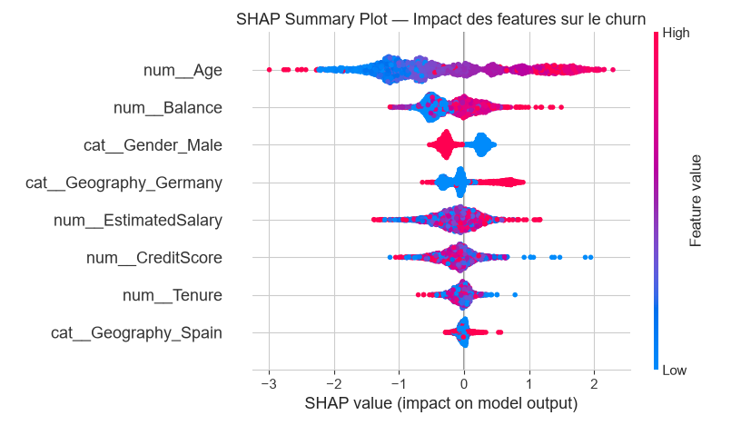

### Arbre de décision interprétable

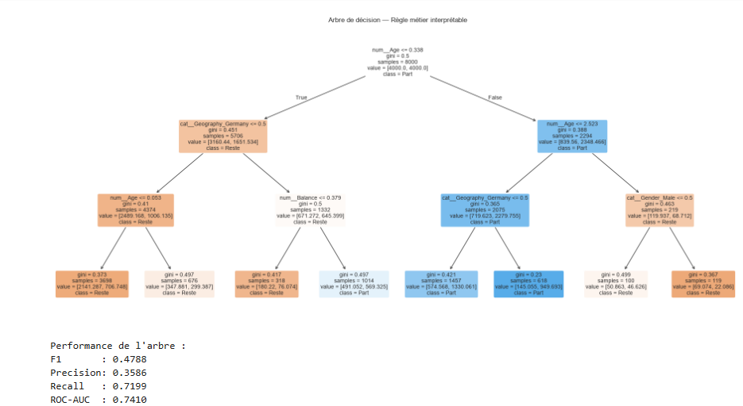

### Top 5 features prédictives

| Rang | Feature | Impact métier |
|---|---|---|
| 🥇 | **Age** | Les clients âgés partent plus (facteur #1) |
| 🥈 | **NumOfProducts** | 3-4 produits = churn massif |
| 🥉 | **IsActiveMember** | Inactifs = 2× plus de churn |
| 4 | **Balance** | Solde élevé → churn (contre-intuitif) |
| 5 | **Geography_Germany** | Allemagne sur-représentée |

### 💡 Règle métier validée

> **Contacter en priorité :**
> - Clients avec **3+ produits**, OU
> - Clients **inactifs** + **âge > 45 ans** + **solde élevé**

⚠️ **Note** : La règle initiale du projet (*« Si Age > 45, NumOfProducts < 2, Balance < 2000€ → 80 % de churn »*) a été **invalidée par les données**. La règle ci-dessus est **construite à partir du modèle** et validée empiriquement.

---

## 📈 Exemples de prédictions

| Profil client | Proba churn | Niveau | Action |
|---|---|---|---|
| 55 ans, Allemagne, 3 produits, inactif, 120k€ | **97.5 %** | 🔴 CRITIQUE | Contacter immédiatement |
| 45 ans, Espagne, 1 produit, inactif, 0€ | **88.6 %** | 🔴 ÉLEVÉ | Contacter rapidement |
| 35 ans, France, 2 produits, actif, 50k€ | **21.0 %** | 🟢 FAIBLE | Aucune action |

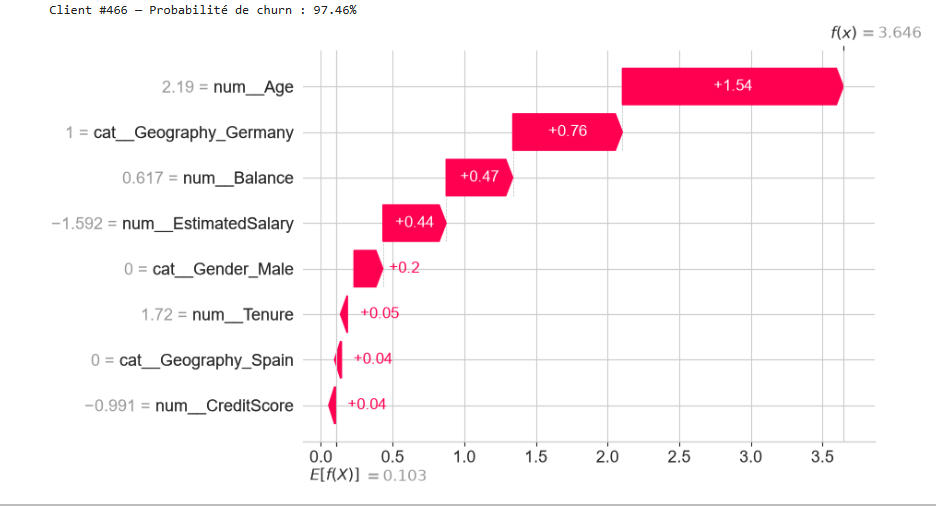

---

## 🏗️ Structure du projet

```
bnp-churn-prediction/
│
├── 📓 EDA.ipynb                       # Analyse exploratoire complète
├── 📓 Extended_Churn.ipynb            # Features + 5 modèles + stacking
├── 📄 RAPPORT.md                      # Rapport de synthèse
├── 📄 README.md                       # Ce fichier
├── 📄 requirements.txt                # Dépendances
├── 📄 .gitignore
│
├── 📁 api/
│   └── main.py                        # API FastAPI
│
├── 📁 assets/
│   ├── 01_modeles.png
│   ├── 02_analyse_bivariee.png
│   ├── ...
│   └── 21_visualisation.png           # 21 graphiques
│
├── 📄 churn_model_catboost.pkl        # Modèle final (211 Ko)
├── 📄 churn_preprocessor.pkl          # Preprocessor (4 Ko)
├── 📄 churn_threshold.pkl             # Seuil optimal (0.58)
├── 📄 churn_metadata.pkl              # Métadonnées
│
├── 📄 clients_a_risque_v2.xlsx        # 1 270 clients à contacter
├── 📄 churn_analysis_final.png        # Graphiques de synthèse
└── 📄 Churn_Modelling.csv             # Dataset source
```

---

## 🚀 Installation & lancement

### Prérequis

- Python 3.10+
- pip

### 1. Cloner le repo

```bash
git clone https://github.com/kabangesylvain-ui/bnp-churn-prediction.git
cd bnp-churn-prediction
```

### 2. Créer un environnement virtuel (recommandé)

```bash
python -m venv venv

# Windows
venv\Scripts\activate

# Mac/Linux
source venv/bin/activate
```

### 3. Installer les dépendances

```bash
pip install -r requirements.txt
```

### 4. Lancer l'API FastAPI

```bash
python api/main.py
```

**Sortie attendue** :

```
OK Modele : CatBoost + FE
OK Seuil  : 0.58
INFO:     Uvicorn running on http://0.0.0.0:8000 (Press CTRL+C to quit)
```

### 5. Tester dans le navigateur

- **Health check** : http://localhost:8000/
- **Swagger UI** : http://localhost:8000/docs

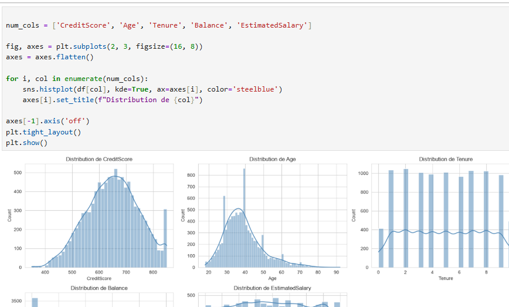

---

## 🔌 API Endpoints

### `GET /` — Health check

Vérifie que l'API est opérationnelle.

```json
{
  "status": "ok",
  "model": "CatBoost + FE",
  "f1_score": 0.6425,
  "threshold": 0.58
}
```

### `POST /predict` — Prédiction de churn

**Requête** :

```bash
curl -X POST "http://localhost:8000/predict" \
  -H "Content-Type: application/json" \
  -d '{
    "CreditScore": 600,
    "Geography": "Germany",
    "Gender": "Female",
    "Age": 55,
    "Tenure": 3,
    "Balance": 120000,
    "NumOfProducts": 3,
    "HasCrCard": 1,
    "IsActiveMember": 0,
    "EstimatedSalary": 80000
  }'
```

**Réponse** :

```json
{
  "churn_probability": 0.9754,
  "prediction": 1,
  "risk_level": "CRITIQUE",
  "action_recommandee": "Contacter immediatement (offre premium)",
  "threshold_used": 0.58
}
```

### 🎯 Niveaux de risque

| Niveau | Proba | Action recommandée |
|---|---|---|
| 🔴 **CRITIQUE** | > 0.80 | Contacter immédiatement (offre premium) |
| 🔴 **ÉLEVÉ** | 0.60 - 0.80 | Contacter rapidement (offre personnalisée) |
| 🟡 **MOYEN** | 0.30 - 0.60 | Surveiller (email de fidélisation) |
| 🟢 **FAIBLE** | < 0.30 | Aucune action nécessaire |

---

## 🛠️ Stack technique

| Catégorie | Technologies |
|---|---|
| **Langage** | Python 3.11 |
| **Data** | pandas, numpy |
| **Visualisation** | matplotlib, seaborn |
| **ML** | scikit-learn, XGBoost, LightGBM, CatBoost |
| **Interprétabilité** | SHAP, feature importance |
| **API** | FastAPI, Pydantic, Uvicorn |
| **Sérialisation** | joblib |
| **Versioning** | Git, GitHub |

---

## 📊 Livrables

| Livrable | Description |
|---|---|
| **Notebooks** | EDA complet + 5 modèles comparés |
| **Modèle final** | CatBoost sérialisé (F1 = 0.6425) |
| **API REST** | Service FastAPI temps réel |
| **Liste clients** | 1 270 clients à contacter (Excel) |
| **Rapport** | Document de synthèse complet |
| **Documentation** | README + Swagger auto-généré |

---

## 🎯 Impact business

| Indicateur | Valeur |
|---|---|
| Clients actifs | 7 963 |
| **Clients à contacter** | **1 270** (16 %) |
| **Lift vs campagne aléatoire** | **×3** |
| **ROI estimé** | 25 - 50 k€ / campagne |

### 📈 Scénario de gain

| Hypothèse | Valeur |
|---|---|
| Marge annuelle / client | 500 € |
| Taux de rétention campagne | 30 % |
| Churners sauvés | ~50 |
| **Gain annuel estimé** | **~25 k€** |

**Avec hypothèse optimiste (rétention 50 %)** : ~50 k€.

---

## 🎓 Compétences mobilisées

### Data Science

- ✅ **Analyse exploratoire** (EDA) : statistiques, distributions, corrélations
- ✅ **Feature engineering** : création de 8 features dérivées
- ✅ **Modélisation** : 7 modèles comparés (LR, RF, XGB, LGB, Cat, Stacking, Voting)
- ✅ **Gestion du déséquilibre** : `class_weight`, `scale_pos_weight`, SMOTE
- ✅ **Évaluation** : F1-score, ROC-AUC, seuil optimal
- ✅ **Interprétabilité** : feature importance, SHAP, arbre de décision

### Ingénierie

- ✅ **Déploiement API** : FastAPI, Pydantic, Uvicorn
- ✅ **Sérialisation** : joblib
- ✅ **Documentation** : Swagger auto-généré
- ✅ **Versioning** : Git, GitHub

### Business

- ✅ **ROI estimation**
- ✅ **Lift calculation**
- ✅ **Règle métier actionnable**

---

## 🚀 Perspectives

| Axe | Action | Gain attendu |
|---|---|---|
| **Modélisation** | Tester CatBoost GPU | Entraînement plus rapide |
| **Features** | Historique transactionnel | +5-10 % F1 |
| **Industrialisation** | Docker + CI/CD | Prod-ready |
| **Monitoring** | Data drift detection | Fiabilité |
| **Business** | A/B testing campagne | Mesure ROI |

### 🔮 Évolutions possibles

- **Déploiement cloud** : AWS Lambda / Google Cloud Run
- **Réentraînement automatique** : Airflow + MLflow
- **Interface utilisateur** : Streamlit pour les commerciaux
- **Intégration CRM** : envoi automatique de la liste des clients à risque

---

## 👤 Auteur

**Sylvain Kabange**

🎓 M2 Data Science — Horizon University  
📧 [kabange.sylvain@horizon-university.tn](mailto:kabange.sylvain@horizon-university.tn)  
🔗 [GitHub @kabangesylvain-ui](https://github.com/kabangesylvain-ui)

---

## 📄 License

Ce projet est sous licence **MIT**. Voir le fichier [LICENSE](LICENSE) pour plus de détails.

---

## 🙏 Remerciements

- **Kaggle** pour le dataset *Churn Modelling*
- **BNP Paribas** pour le contexte métier
- **Horizon University** pour l'encadrement académique

---

<div align="center">

⭐ **Si ce projet vous a plu, n'hésitez pas à lui donner une étoile !** ⭐

[](https://github.com/kabangesylvain-ui/bnp-churn-prediction)

**Dernière mise à jour** : Octobre 2026

</div>
